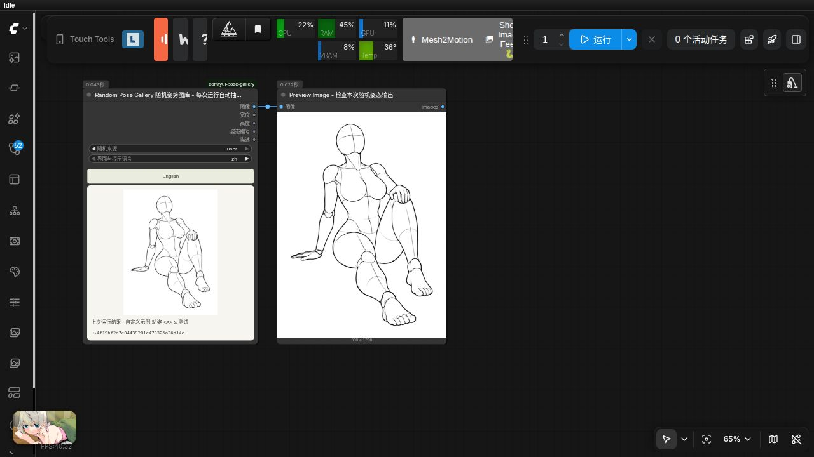
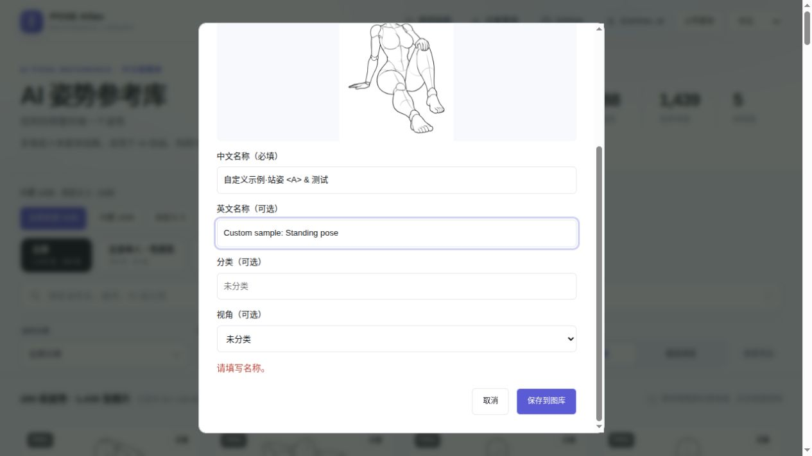
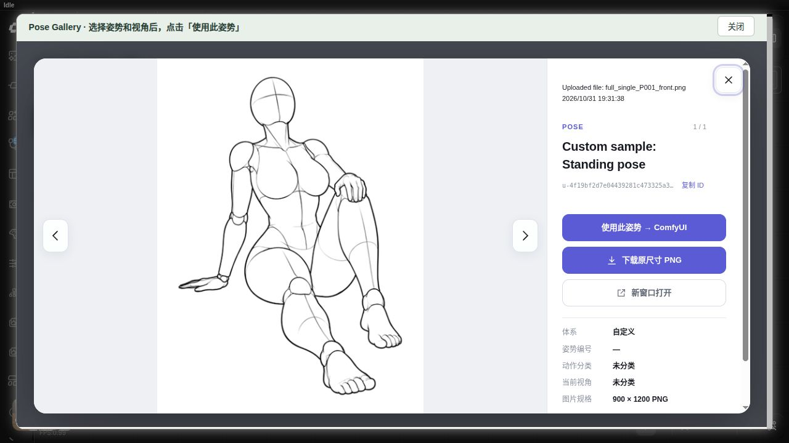
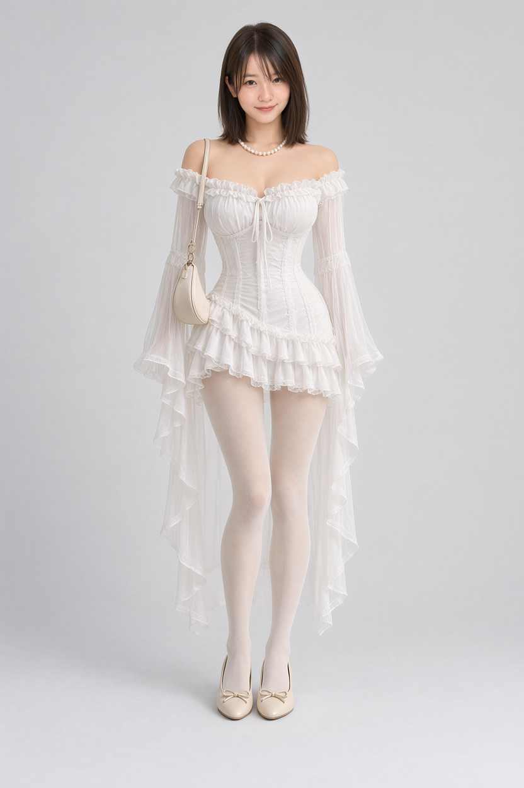
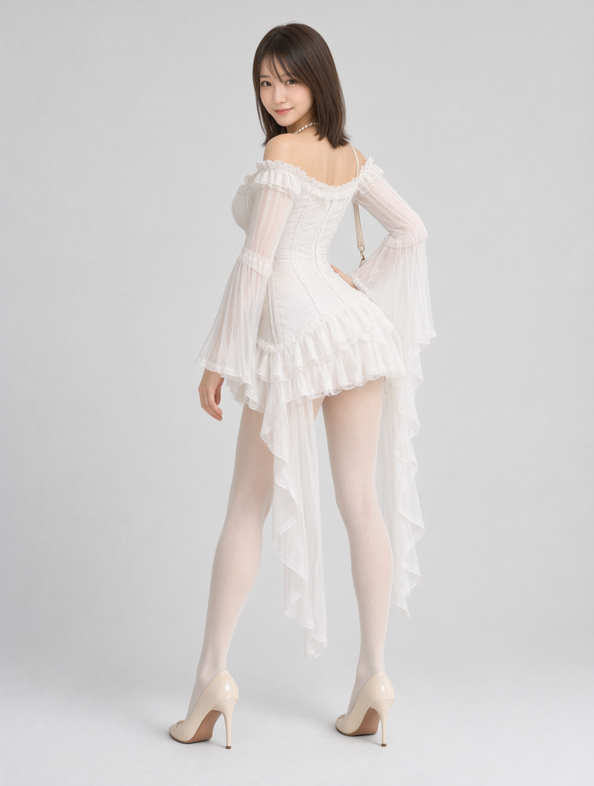

# comfyui-pose-gallery

**简体中文** · [English](README.en.md)

支持旧画布和 **Nodes 2.0**（ComfyUI 前端 1.57.4 实测），包括浏览选图、预览、骰子和锁定。更新后请强制刷新页面加载新版前端脚本。

ComfyUI 本地中文姿势图库节点。参考并改编 [ai-pose-gallery-zh](https://github.com/wangweihong/ai-pose-gallery-zh) 的画廊界面：1,439 张原图，288 组姿势，最多 5 个视角。


## 每次运行随机：独立节点

添加 **image → Pose Gallery → Random Pose Gallery 随机姿势图库**，将 `image` 接入后续工作流或 Preview Image。每次执行会重新随机抽取一张原图，无需点击随机按钮。`origin` 可选 `all`（全部）、`builtin`（内置）或 `user`（自定义）。姿态按单张视角记录抽样，不自动生成或补造其他角度。

原 **PoseGallery** 保留原有必填输入、固定选图、5 个输出和连线，新增可选 `language` 输入（旧工作流默认 `zh`）。两个节点在原有 5 个输出之后追加第 6 个 `action` 输出，仅包含动作名称，以英文逗号分隔，例如 `Deep kneeling backbend,Holding both heels`。所有数据对应同一张实际抽中的素材；执行后显示编号和预览。两个节点的 `language` 同时控制界面、`description` 和 `action` 输出语言；`en` 输出英文体系、分类、姿势名称和视角，`zh` 保留中文描述。其他输出不变。

点击节点上的 **🎲 随机**，无需运行工作流即可按节点的来源、体系和视角筛选抽取并预览姿态。有多个候选时，点击骰子会避开当前姿态。打开 **🔒 锁定随机** 后，骰子禁用，后续运行固定输出当前 `pose_id` 对应的图像、描述和动作；锁定状态和姿态编号随工作流保存。先点击骰子或运行一次取得姿态，再锁定。锁定后修改筛选不会改变当前姿态；如果原图已删除或清理，会明确报错，不会偷偷改抽其他图片。

解锁后恢复每次运行自动随机，运行抽样仍可能偶然重复。不受浏览页面筛选影响；缺失原图会跳过，无可用图片时明确报错。未锁定时，预览编号不固定下次运行的抽样。节点本身不会启动或追加任务。

导入 [随机姿态预览示例](example_workflows/random_pose_preview.json)，附同名 API 工作流。

随机姿势新增可选 `pose_system`（体系）和 `angle`（视角）；随机人像新增 `section`（`face` / `styling` / `custom`）。这些筛选默认 `all`，旧随机流程行为不变。




## 单张上传自定义姿态

1. 在独立图库或节点内嵌图库的顶部点击 **上传姿态**。
2. 选择一张现成参考图，查看预览，填写名称。另一语言名称可选；未填写时沿用已有名称，不自动翻译。顶部 **中文 / English** 切换整个图库：体系、动作分类、视角、288 组姿势名称、详情、帮助说明及上传控件。切换时保留筛选、当前姿势和视角；语言选择会在下次打开时恢复。
3. 点击 **保存到图库**。成功后切换到“自定义”来源，清除分类、搜索等筛选，并打开新素材的大图。
4. 在大图中点击 **使用此姿势 → ComfyUI**，写回当前节点；上传和选择都不会自动运行或排队。

内置多视角分组保持不变；上传的单图独立成组，不补造其他视角。分类与视角可选，默认未分类。

支持静态 PNG、JPEG、WebP，一次一张，限制 **20 MiB、3200 万像素**。服务端检查实际内容，拒绝动画、损坏图片和越界路径。完整图片转为 PNG，保留尺寸和透明度；生成 800×1000 内的 WebP 预览、400×500 内的 WebP 缩略图。节点 IMAGE 输出的透明部分合成白色。上传仅导入图片，**不自动提取、抠图、去背景或修改人物**。自定义上传目前不含批量导入、编辑和删除；内置素材可通过下方素材管理清理或替换。

自定义数据保存在 **`ComfyUI/user/pose_gallery/`**，独立于节点代码与内置素材；升级代码不会覆盖：

- `data/custom.json`：稳定 `u-` + UUID 编号、中英文名称、分类、原文件名、尺寸、上传时间和校验值。
- img/（PNG）、preview/（WebP）、thumbs/（WebP）：完整图、预览与缩略图，按同一编号对应。
- 备份时请单独备份此用户目录。本地 ComfyUI 服务的客户端共享该库，没有账号或多用户权限隔离。
- 可用 `COMFYUI_POSE_GALLERY_USER_LIBRARY` 指定其他持久化、可写且容器内可见的目录。

新增 **全部来源 / 内置 / 自定义** 筛选与独立数量统计；缺少内置索引时仍可上传与使用自定义素材。保留现有 **5 个输出**、旧编号和连线兼容；自定义编号用于 `pose_id`，`source_id` 元数据为空，不冒用原站编号。

接口：`POST /pose_gallery/upload`，multipart 字段 `image`、`name`，可选 `other_name`、`language`（zh/en）, `category`、`angle`（unknown/front/top/bottom/side/diagonal）。成功返回201及 `record`、包含 `records` 和 `meta` 的 `catalog`；失败返回错误代码。索引加锁并原子替换，失败回滚本次新文件。`GET /pose_gallery/catalog` 保持数组格式，并增加 `origin=builtin/user`；`GET /pose_gallery/meta` 提供数量与缺失状态。图片接口只读取索引中登记的文件。





## 编辑、删除与替换内置姿势

- **整组删除**：点击图库顶部 **编辑**，直接勾选姿势卡片，再点击 **删除选中姿势**。删除的是整组及其全部视角；可先用图库现有的搜索、体系和分类缩小范围，也可全选当前结果。点击 **完成** 退出编辑。
- **单个视角**：打开姿势大图并选中视角，在 **新窗口打开** 下方直接点击 **删除** 或 **替换**。删除只影响当前视角；替换时选择一张正确的 PNG/JPEG/WebP（最多 20 MiB、3200 万像素），确认替换即可，原 ID 和其他视角保持不变。
- 删除会移除该素材的全部图片文件并释放空间；已删除素材不再出现在图库或随机池中。删除前会确认影响范围。

顶部 **管理内置素材** 专门用于插件更新后的统一处理，不显示图片列表，也无需再次勾选素材：

| 选项 | 继续之前的操作 | 使用更新后的内置素材 |
| --- | --- | --- |
| 以前删除的姿势 | 再次删除 | 保留，并停止继续删除这些素材 |
| 以前替换的姿势 | 再次使用我的替换图 | 使用内置图，并停止继续替换这些素材 |

两个选项独立选择，点击 **执行** 后显示删除、替换、保留和失败数量。这里只处理本地已有文件，不下载素材；选择保留时若文件尚未恢复，会报告失败并保留相应操作记录，供更新后重试。

插件启动、浏览和更新后都不会自动清理或替换。操作记录保存在 `ComfyUI/user/pose_gallery/data/builtin_changes.json`，替换源文件保存在 `ComfyUI/user/pose_gallery/replacements/<id>/<revision>/`；备份时一起保存，同一服务的客户端共享这些数据。替换源和历史版本会保留。基础索引不修改，文件操作只允许登记的内置 ID，拒绝越界路径和符号链接。删除工作目录图片不会清理 Git 历史对象。

开发接口：`GET /pose_gallery/manage/summary` 返回删除、替换记录数量；`POST /pose_gallery/manage/plan` 可接受 `{choices: {deleted: "delete" / "keep", replaced: "replace" / "keep"}}` 统一规划，或 `{ids, mode}` 规划指定素材；`POST /pose_gallery/manage/apply` 接受规划返回的 `{request, token}` 执行。`POST /pose_gallery/manage/replacement` 接受 multipart `id`、`image`，校验图片并准备替换源。界面将内部规划与执行合并为一次用户操作。正在运行的旧服务可通过兼容接口完成相同操作，无需为更新界面中断任务。


## 使用

添加 **image → Pose Gallery → Pose Gallery 姿势图库**，点击“浏览姿势图库”，按中英文关键词、编号或 ID 搜索，使用体系、动作和视角筛选。点卡片进入大图，切换视角，点击“使用此姿势 → ComfyUI”。所选 ID 会保存在节点及工作流中，节点显示当前原图。

输出：`image`（RGB，900×1200）、`width`、`height`、`pose_id`、`description`、`action`。`action` 只保留姿势名称，将 `·` / `・` 分隔符替换为英文逗号，不附加体系、分类或视角，并跟随 `language` 选择语言。固定选图节点的语言输入会与图库语言选择同步，并随工作流保存；切换语言后重新运行，`description` 才会更新。自定义素材使用已填写的对应语言名称，未提供译名的自定义文字仍沿用原文。输出 `image` 可连接 Depth Anything、图像预览及其他图像节点。不自动入队；用户点击 ComfyUI“运行”开始生成。

## 工作流选择

| 工作流 | 输入与用途 | 本地实测 |
| --- | --- | --- |
| [MOSS 深度控制参考版](example_workflows/pose_gallery_moss_sft50_reference.json) | 图库姿势 → Depth Anything 深度图 → 根据文字生成角色 | SFT 50 步，ER-SDE，896×1184，约 46.4 秒 |
| [Anima 动漫姿态生图](example_workflows/pose_gallery_anima_lllite_v2.json) | 图库线稿 + 文字 → Anima LLLite v2 生成动漫人物 | Miaomiao Harem Anima 1.1、动作关键词联动，30 步、CFG4 |
| [Qwen Image 2.1 两阶段换脸换装与姿态编辑](example_workflows/01_QwenImage2.1_换脸换装与姿态编辑_两阶段.json) | 人物＋服装＋人像先替换，再按图库姿势编辑 | 两阶段各25步，第二阶段PoseStudio V2，896×1184 |
| [Qwen Image 2.1 双人姿态编辑](example_workflows/02_QwenImage2.1_PoseGallery_双人姿态编辑实测.json) | 双人姿势 + 两张人物参考，收录本机保存配置；[输入顺序和使用说明](example_workflows/qwen21_pair_pose_gallery.md) | 25 步，Euler/simple；本次收录仅做结构与素材校验 |
| [Z-Image-Turbo 深度控制实测](example_workflows/z_image_turbo_pose_gallery.md) | 图库姿势 → Depth Anything V2 → Union 2.1 2602 八步控制 | 8 步、CFG1；四组结果含空白脸及动作偏差，附 0.65 强度对照；与 issue 原 Union v1 有版本差异 |
| [Krea2 深度控制](example_workflows/pose_gallery_krea2_depth.json) | 图库姿势 → Depth Anything V2 → Krea2 Turbo 深度控制文生图 | 8 步，ER-SDE，896×1184，热加载约 9.4 秒 |

下方提供实际 ComfyUI 截图及姿势与成图对照。运行时间受硬件、模型加载与缓存影响。

## 安装

在 `ComfyUI/custom_nodes` 目录执行：

```bash
git clone https://github.com/wangweihong/comfyui-pose-gallery.git
```

重启 ComfyUI 并刷新浏览器。仓库已直接包含 **1,439 张原尺寸 PNG、1,439 张 JPG 缩略图和中文索引**。克隆后即可离线浏览、预览原图，并将所选姿势输出给工作流，无需运行额外的素材下载脚本。完整素材约 660 MB。

```text
comfyui-pose-gallery/
└── library/
    ├── data/       # 中文姿势索引和分类
    ├── img/        # 1,439 张原尺寸 PNG，900×1200
    ├── thumbs/     # 1,439 张缩略图 JPG，300×400
    └── SOURCE.json # 素材来源和版本
```

### 已安装旧版：补齐原图

旧版仓库仅包含缩略图，可能出现“图库能浏览，但使用此姿势后节点不显示图片”。在节点目录更新即可：

```bash
cd ComfyUI/custom_nodes/comfyui-pose-gallery
git pull
```

更新后重启 ComfyUI，并强制刷新浏览器（Ctrl+Shift+R）。如果更新工具不会补齐素材，确认当前安装目录下存在 `library/img/`；不要只复制 `web/` 或缩略图目录。

若原图加载失败，节点会显示对应图片路径和更新提示，不再只显示空白。使用 `COMFYUI_POSE_GALLERY_LIBRARY` 时，该自定义目录也必须包含完整的 `data/`、`img/` 和 `thumbs/`。

`scripts/install_library.py` 保留用于手动修复或从已有的原图库 Git clone 复制素材，正常安装不需要执行它。

节点依赖均使用 ComfyUI 已有的 Pillow、NumPy、PyTorch、aiohttp。

高级：`COMFYUI_POSE_GALLERY_LIBRARY` 可指定服务器上已有的完整图库根目录（含 data、img、thumbs）；默认使用本插件 `library/`。浏览器只能读取元数据允许的图片，路径穿越和外部文件符号链接会被拒绝。

## Depth Anything → MOSS SFT 50 步

导入 `example_workflows/pose_gallery_moss_sft50.json`；`.api.json` 是服务端 API 格式。

链路：Pose Gallery → Depth Anything V2 Large → 1056×1408 等比缩放 → MOSS-Image Color/Depth Control → MOSS SFT → 保存。

工作流依赖：

- ComfyUI 0.43.0（本机已测试），含原生 MOSSImageControl、MOSS 模型支持。
- `comfyui_controlnet_aux`，Depth Anything V2 Large 权重。
- `models/diffusion_models/moss/moss_image_sft_bf16.safetensors`
- `models/text_encoders/moss/qwen3.5_9b_int8_convrot.safetensors`
- `models/vae/moss/flux2-vae.safetensors`
- `models/loras/moss/moss_image_color_depth_control.safetensors`，来自 [Comfy-Org/MOSS-Image](https://huggingface.co/Comfy-Org/MOSS-Image)，适配器作者 [darask0](https://huggingface.co/darask0/MOSS-Image-color-depth-control)。

50 步、CFG 3、Euler、sgm_uniform、Shift 5、负向跳过单流层 22。控制 LoRA 强度 1.0；深度强度 0.75，开始 0，结束 0.5。提前结束深度控制用于减少素体外观。深度输入采用近白远黑的灰度图。

切换姿势时，同时调整正向提示词中的动作；描述服装、脸部、环境和光线。深度图约束轮廓与前后关系，手指和脸部仍由模型生成。调整分辨率时，同时修改深度缩放和 Empty Flux 2 Latent 的尺寸。若想更严格约束，逐步调高 depth strength/end_percent。

运行保存路径相对于 **ComfyUI output**：

- `images/moss/pose/depth/pose_depth_*.png`
- `images/moss/pose/result/moss_sft50_pose_*.png`

PNG 包含实际 API 参数和可导入工作流。开发工作区的 `images/moss/pose/` 另外保留实测文件、历史和界面证据；这些本机文件不包含在此源码仓库中。

## 参考简化版 ER-SDE 工作流

导入 `example_workflows/pose_gallery_moss_sft50_reference.json` 使用参考版；对应的 `.api.json` 可通过 ComfyUI API 执行。该版本参考 `moss_image_control_depth_simple.json` 的采样配置，接入 Pose Gallery 和 Depth Anything，并使用常规 SFT 50 步。

- 参考文件的 101 号节点使用 `moss_image_color_depth_control.safetensors`，本机对应 `moss/moss_image_color_depth_control.safetensors`。
- 该 [Comfy-Org 文件](https://huggingface.co/Comfy-Org/MOSS-Image/blob/main/loras/moss_image_color_depth_control.safetensors) 与作者的 [moss-control.safetensors](https://huggingface.co/darask0/MOSS-Image-color-depth-control/blob/main/moss-control.safetensors) 字节一致，SHA-256 均为 `e5c0c3efd05e4269207a39de6005798f14c90c6687c89c54eaffe4b76c43a763`。
- 采用参考参数：ER-SDE、simple、TSR 0.95 / sigma 1、CFG 3、Shift 5、深度强度 0.5、控制范围 0–0.6。
- 参考文件 SLG 标题写着第 22 层，实际 `single_layers` 为 `24`；此版本明确采用实际数值 24。
- 参考文件外层为 24 步，本版保留用户要求的 50 步。主模型使用本机 SFT BF16；Turbo LoRA 不启用。
- 深度图按原比例缩放到约 1 MP，通过 GetImageSize 自动连接潜空间宽高；使用兼容 MOSS 的 EmptyFlux2LatentImage。
- 结果保存为 `images/moss/pose/depth/reference_depth_*.png` 和 `images/moss/pose/result/reference_ersde_sft50_*.png`（相对于 ComfyUI output）。

### MOSS 使用步骤与示例

1. 安装 `comfyui_controlnet_aux` 并准备上文模型。导入[ER-SDE 参考版工作流](example_workflows/pose_gallery_moss_sft50_reference.json)，在模型节点选择本机权重。
2. 在 Pose Gallery 浏览图库并点击“使用此姿势 → ComfyUI”，检查节点原图是否显示。
3. 修改正向提示词中的人物、服装、场景和动作，再运行。Depth Anything 自动从图库线稿生成深度图，MOSS 根据深度与文字生图。
4. 在 `output/images/moss/pose/depth/` 和 `output/images/moss/pose/result/` 查看深度图及成图。

以下为参考版 ER-SDE 50 步的实际运行截图；深度强度 0.5、控制范围 0–0.6，完整参数见上文。截图展示采样与输出区域，导入 JSON 可查看完整连线。


| 图库原图：P031 正面 | Depth Anything 深度图 | MOSS 生成结果 |
| --- | --- | --- |
|  |  |  |

姿势 ID：`full_sexy_P031_front`。示例人物穿绿色上衣与米色长裤，姿态为跪姿、双手置于脑后。深度约束整体轮廓，人物细节和背景由提示词生成。

## Qwen Image 2.1 · 换脸换装与姿态编辑

旧工作流已直接替换并按实际功能命名，不再沿用错误的 MOSS 名称。

| 工作流 | 可视化 JSON | API JSON | 作用 |
| --- | --- | --- | --- |
| 01 两阶段换脸换装与姿态编辑 | [导入](example_workflows/01_QwenImage2.1_换脸换装与姿态编辑_两阶段.json) | [API](example_workflows/01_QwenImage2.1_换脸换装与姿态编辑_两阶段.api.json) | 第一阶段换脸换装，第二阶段通过PoseStudio V2迁移姿势 |

需要同时安装 pose、portrait、costume 三个图库。请先将[附带原人物图](example_workflows/assets/h3_bfs_original_teal_character_20261014.png)复制到 `ComfyUI/input/`，或在 Load Image 中选择自己的参考图。模型路径、参考职责和测试范围见[完整指南](example_workflows/qwen21_gallery_workflows.md)。

01 保留已经成功的第一阶段配置。第二阶段使用**图1姿势图库线稿、图2第一阶段解码成图**，仅第二阶段模型分支加载 QI2.1 PoseStudio V2 LoRA（强度1）。25步、CFG1、Euler/simple、固定种子2026103002。完整链路已实测，第一阶段输出与修复前结果的RGB像素完全相同；P003的背侧转身、回头和扶腰已跟随。其他姿势、手指与服装背面细节仍需检查。





## Krea2 · Pose Gallery 深度控制

导入 [Krea2 深度工作流](example_workflows/pose_gallery_krea2_depth.json)，或使用 [P002 站姿对照版](example_workflows/pose_gallery_krea2_depth_standing.json)。两份工作流均有同名 `.api.json`。链路为 Pose Gallery → Depth Anything V2 Large → Krea2 Control Image Encode / Apply → Krea2 Turbo；具体依赖、模型路径和操作步骤见[完整使用说明](example_workflows/krea2_pose_gallery.md)。

本地实测在相同提示词和种子下，仅切换图库姿势，分别生成对应跪姿与站姿。提示词只描述人物、服装、场景和画风，无需填写固定动作。896×1184、8 步、CFG 1、ER-SDE/simple、深度控制强度 1；首轮含模型冷加载约 67.8 秒，模型已加载后约 9.4 秒。它是文生图流程，人物由文字生成，没有人物身份参考图输入。

| 图库原图 | Krea2 生成结果 |
| --- | --- |
|  |  |
|  |  |

原图、深度图和成图分别保存在 `output/images/krea2/pose_gallery/poses/`、`depth/` 和 `results/`。目前只验证上述两组，手脚细节和精确关节角度仍可能偏离参考；详细记录见[实测摘要](example_workflows/pose_gallery_krea2_validation.json)。

## Anima · 图库姿态与动作关键词联动

导入 [Anima LLLite v2 工作流](example_workflows/pose_gallery_anima_lllite_v2.json)，按[依赖和操作说明](example_workflows/anima_pose_gallery.md)准备主模型、编码器、VAE及LLLite v2控制权重。示例已替换为本地工作流 `7e7b00cd-133b-4b2f-8212-1ee3d87338ea` 的已保存版本：Miaomiao Harem Anima 1.1，图库线稿控制姿态，`action → Show Text → Concatenate Text` 将动作关键词追加到正向提示词。原提示词、连线与旁路状态保持来源配置，详见操作说明。

新版默认 30 步、CFG4、ER-SDE/simple、控制强度 1、范围 0–0.9，约 1MP 等比缩放。下方 8 组结果属于旧 Anima Base v1 均衡工作流（强度 0.75），当时模型已加载时平均约 9.4 秒/张。主要动作有跟随；单膝跪和俯卧存在肩部构造线转成服装/装饰的问题，蹲姿头部角度有偏移，其他姿势与随机种子仍需分别评估。


每组左侧为图库姿势，右侧为实际Anima生成结果：


[逐组原图、成图和评价](example_workflows/anima_pose_gallery.md) · [JSON实测记录](example_workflows/pose_gallery_anima_validation.json)。

## 素材和许可

节点代码及改编的画廊页面遵循 MIT；保留上游声明，详见 LICENSE、NOTICE.md。图片及原始数据权利属于原作者ギア，中文数据由 Anhao 整理，不适用代码 MIT 许可。仓库的 `library/img/`、`library/thumbs/` 和 `library/data/` 包含来自原图库的原尺寸图片、缩略图及中文索引，并保留素材来源和上游许可说明；这些素材不适用节点代码的 MIT 许可。原站链接和来源说明保留，已移除上游统计脚本。

## 验证

`python -m unittest discover -s tests -v` 检查目录边界、非法 ID、文件缺失和符号链接逃逸。本次还实际验证了 ComfyUI 注册、图库接口、浏览器搜索与视角切换、选择写回和完整 SFT 50 步生成。

```bash
node --test tests/test_random_frontend.cjs
```
