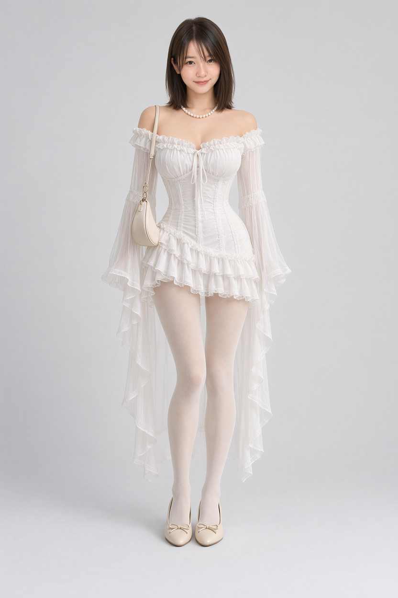
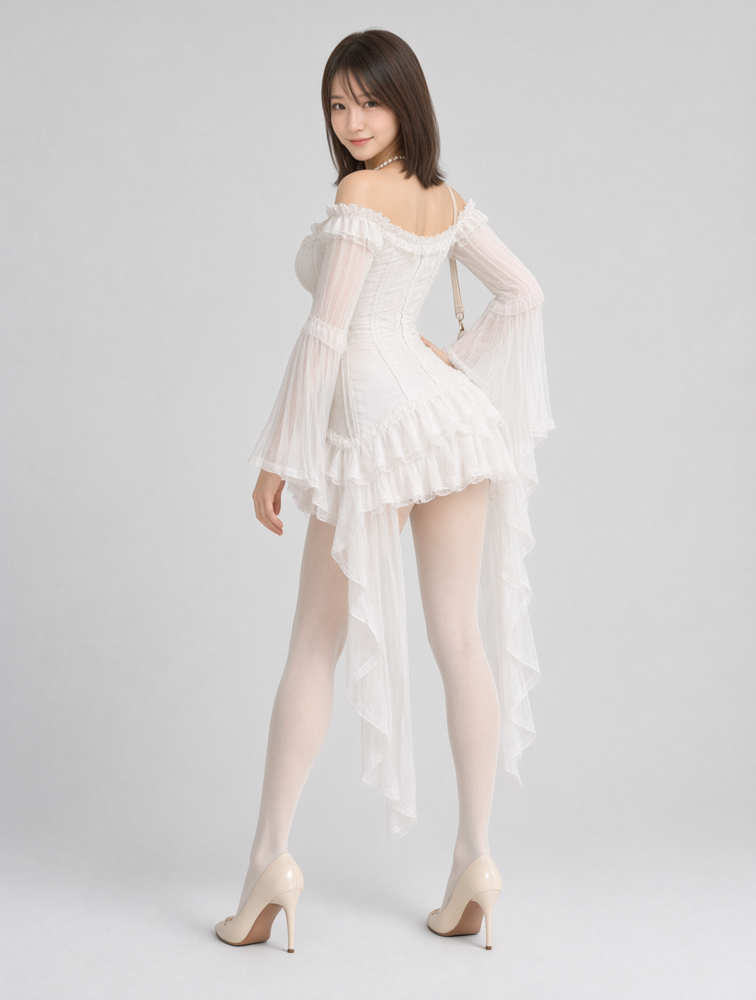

# Qwen Image 2.1 图库示例

## 工作流与仓库范围

| 示例 | 可视化 JSON | API JSON | 内容 |
| --- | --- | --- | --- |
| 01 两阶段换脸换装与姿态编辑 | [导入工作流](01_QwenImage2.1_换脸换装与姿态编辑_两阶段.json) | [API](01_QwenImage2.1_换脸换装与姿态编辑_两阶段.api.json) | 先替换人物与服装，再通过PoseStudio编辑姿势 |

01 替换旧的修复前示例，来源工作流 ID 为 `d4063c2c-fcb7-4a51-acbe-13ca5a7d9a10`。02 三图换脸换装工作流仅发布到portrait和costume仓库。

## 安装与使用

1. 安装 [comfyui-pose-gallery](https://github.com/wangweihong/comfyui-pose-gallery)、[comfyui-portrait-gallery](https://github.com/wangweihong/comfyui-portrait-gallery)、[comfyui-costume-gallery](https://github.com/wangweihong/comfyui-costume-gallery)。01 需要这三个图库；02 只需要 portrait 和 costume。
2. 将 [`assets/h3_bfs_original_teal_character_20261014.png`](assets/h3_bfs_original_teal_character_20261014.png) 复制到 `ComfyUI/input/`，或在 Load Image 中选择自己的原人物图。该 PNG 已随本仓库附带。
3. 导入 JSON，在加载器中按本机路径重选权重。切换 Portrait Gallery 的目标脸和 Costume Gallery 的目标服装。
4. 使用 01 时，在 Pose Gallery 选择目标姿势后运行；第二阶段固定为图1姿势参考、图2第一阶段成图。请保留第二阶段独立的LoRA模型分支。
5. 两份流程都沿用实测采样：25步、CFG1、Euler/simple、denoise 1、固定种子2026103002、编码器resolution 1024。01 分两次采样；02 只采样一次。

## 参考图分工

- 01 第一阶段：图1原人物、图2服装、图3目标人像。第二阶段：图1姿势图库线稿、图2第一阶段VAE解码图。
- 02：图1原人物、图2服装、图3目标人像；不包含MOSS、深度估计或姿势编辑阶段。
- 输入图的编号由连线决定。请勿把姿势线稿与人物照片接反。

## 模型

路径均相对于 `ComfyUI/models/`；权重不随仓库分发。

| 类型 | 本机路径 |
| --- | --- |
| Qwen Image 2.1 BF16 | `diffusion_models/image2image/qwen_image_2.1_bf16.safetensors` |
| Qwen3-VL 8B | `text_encoders/text_encoders/qwen3vl_8b_bf16.safetensors` |
| Qwen Image 2.1 VAE | `vae/vae/qwen_image_2.1_vae_bf16.safetensors` |
| 仅01第二阶段：PoseStudio QI2.1 v2 | `loras/qwen2.1/动作编辑VNCCS_QI2_PoseStudioV2_3294845.safetensors` |

01 的PoseStudio LoRA强度为1，仅接入第二阶段；第一阶段继续使用基础模型。不要使用QIE2511版本的姿态LoRA替代QI2.1版本。

## 实测

01 已完整运行成功，姿势 `full_sexy_P003_front` 的背侧转身、回头与扶腰生效；第一阶段结果与修复前成功图的RGB像素完全一致。仅加强提示词的基础模型对照仍保留正面站姿，因此第二阶段加入了姿态适配器。结果尺寸832×1248（第一阶段）和896×1184（第二阶段）。02 沿用来源工作流最近一次成功执行的三图输入和提示词。

UI重新加载后导出的API输入已与执行版本逐项核对。当前只验证指定参考图、姿势及固定种子；复杂遮挡、手指、背面衣物和其他姿势仍需目视检查。

输出保留原目录：第一阶段/02为 `output/images/qwen/gallery/results/face_swap_*.png`，01第二阶段为 `output/images/qwen/gallery/results/pose_swap_*.png`。原工作流备份和历史示例可从Git历史恢复。
