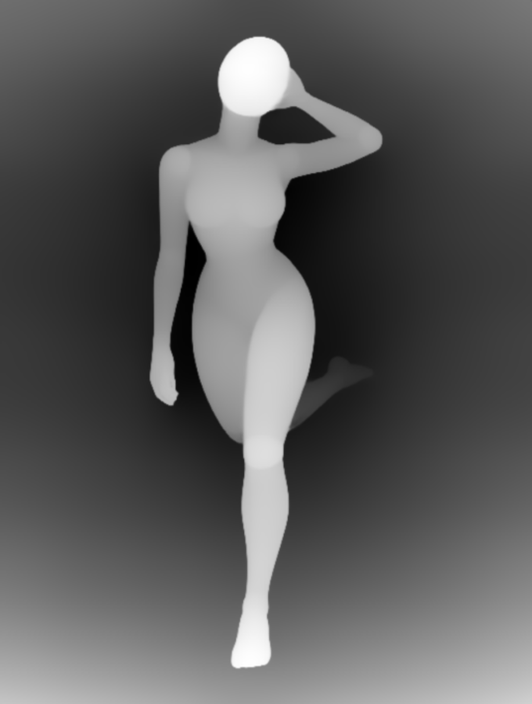
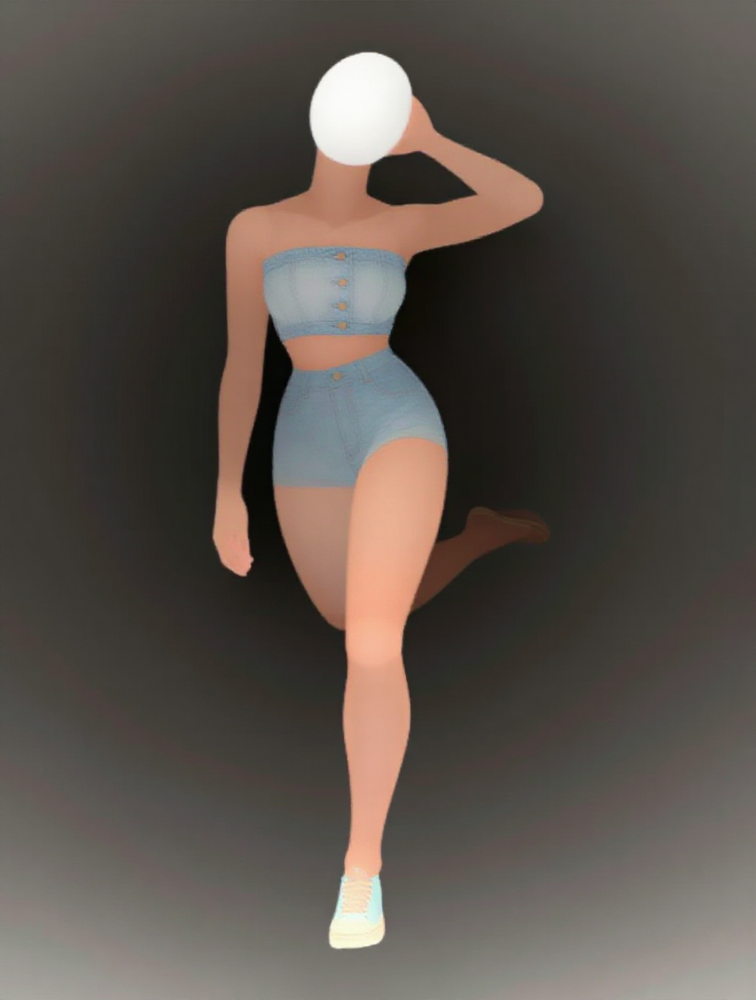
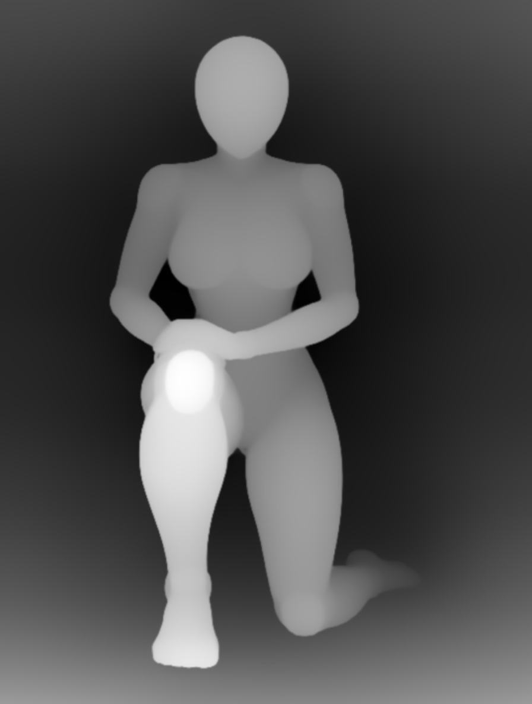
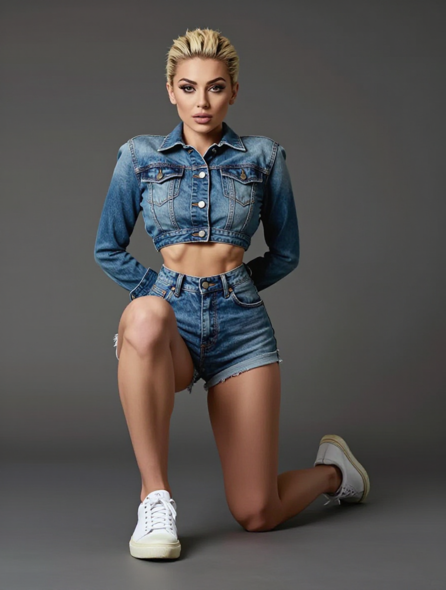
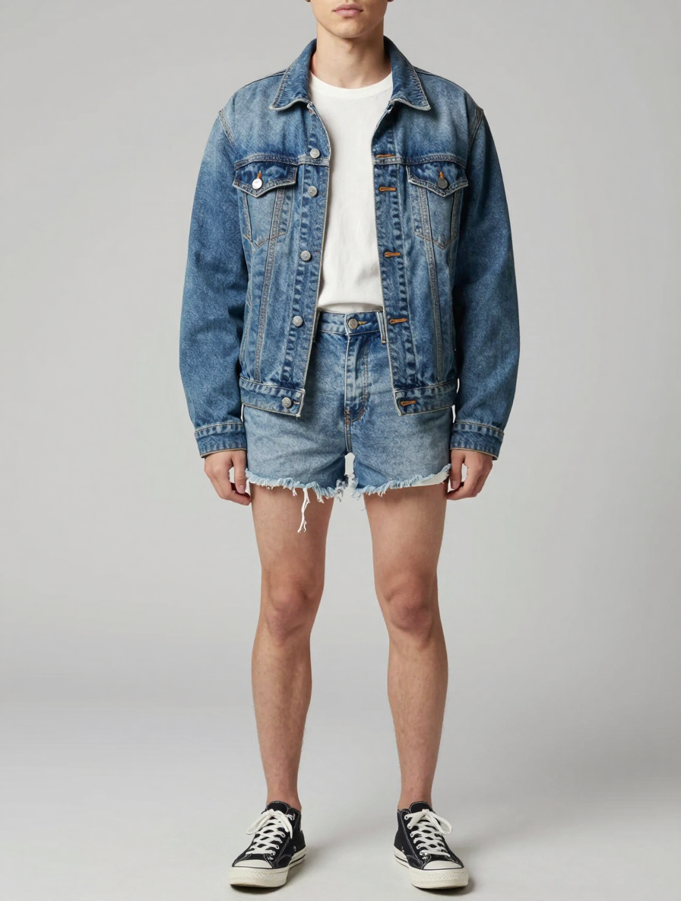
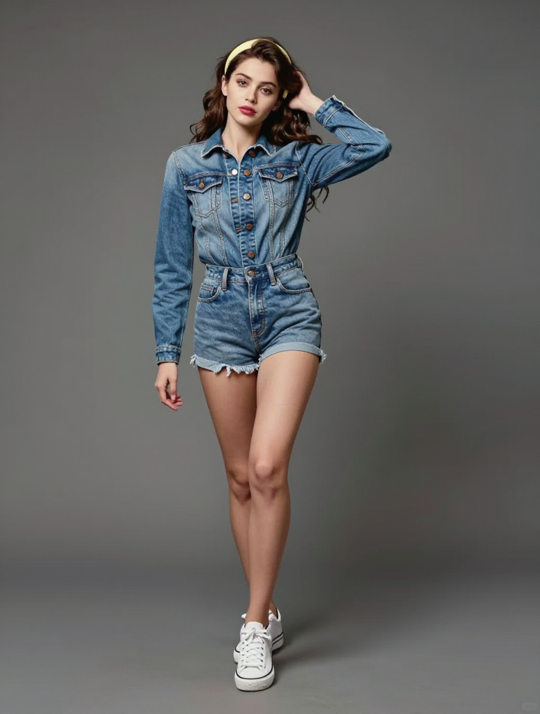

# Z-Image-Turbo · Pose Gallery 深度控制实测

根据 [issue #2](https://github.com/wangweihong/comfyui-pose-gallery/issues/2) 的[原始工作流评论](https://github.com/wangweihong/comfyui-pose-gallery/issues/2#issuecomment-6554955537)改编，2026-11-02 在本机 ComfyUI 执行四组测试。

**本机没有原帖的 Union v1，本次使用 Union 2.1 2602 8steps。因此这是版本适配测试，不是同权重严格复现。** 模型均使用本地已有文件，没有下载新模型，也没有做同条件 MOSS 对照。

## 导入与依赖

- [01 · 原采样参数、控制强度 0.8](01_ZImageTurbo_PoseGallery_Union21_原参数8步.json)（[API](01_ZImageTurbo_PoseGallery_Union21_原参数8步.api.json)）。默认姿势为 `full_single_P024_front`。此配置会出现空白脸，保留用于复查原参数效果。
- [02 · 控制强度 0.65 对照](02_ZImageTurbo_PoseGallery_Union21_强度065对照8步.json)（[API](02_ZImageTurbo_PoseGallery_Union21_强度065对照8步.api.json)）。改善人物质感，但腿部动作跟随变弱。

安装本图库和 [comfyui_controlnet_aux](https://github.com/Fannovel16/comfyui_controlnet_aux)，准备 Depth Anything V2 Large 的 `depth_anything_v2_vitl.pth`。ComfyUI 需支持原生 `ModelPatchLoader`、`ZImageFunControlnet`、`ModelSamplingAuraFlow` 等节点。模型不随仓库分发，导入后在各加载器中重新选择本机路径：

| 模型 | 本机测试时的加载器路径 |
| --- | --- |
| Z-Image-Turbo BF16（diffusion_models） | `text2image/z_image_turbo/z_image_turbo_bf16.safetensors` |
| Qwen3 4B（text_encoders） | `text2image/qwen_3_4b.safetensors` |
| AE（vae） | `zimage-turbo/split_files/vae/ae.safetensors` |
| Fun ControlNet（model_patches） | `Z-Image-Turbo-Fun-Controlnet-Union-2.1-2602-8steps.safetensors` |

CLIP 类型使用 `lumina2`。控制权重版本见[作者模型说明](https://huggingface.co/alibaba-pai/Z-Image-Turbo-Fun-Controlnet-Union-2.1)，普通 2.1 与 2602 八步蒸馏版应区分。

链路：Pose Gallery → Depth Anything V2 Large（预处理分辨率 512）→ 等比缩放到 1 MP → Fun ControlNet → ZIT。深度图宽高自动传入潜空间，实测输出为 896×1184。

保持原工作流提示词及 8 步、CFG 1、`res_multistep` / `simple`、shift 3、seed 20261102、denoise 1、控制范围 0–1。原正向提示词如下：

```text
best quality,masterpiece,realistic,absurdres,realistic,Highly detailed,simple background,(Denim_jacket:1.4),(High-waisted_shorts:1.3),(Sneakers:1.2),
```

在图库选择姿势后手动运行。姿势原图、实际深度条件和结果保存至 ComfyUI `output/images/z-image-turbo/pose-gallery-issue2/`；02 使用独立的强度对照子目录。两份文件均完成实际 UI 导入与 `graphToPrompt` 序列化核对，执行输入与对应 API 文件一致。

## 四组实际结果

| 测试 | 姿势 ID / 强度 | 耗时 | 目视结果 |
| --- | --- | --- | --- |
| 原站姿 | `full_single_P024_front` / 0.8 | 87.95 秒，含首次冷加载 | 举手与单腿后抬轮廓跟随，但脸部空白、呈扁平人偶感。 |
| 单膝跪姿 | `full_single_P033_front` / 0.8 | 8.18 秒 | 单膝跪与前侧抬膝总体跟随，人物服装可成图；双手被放到身后，没有放在膝盖上。 |
| 关闭控制 | `full_single_P024_front` / 0 | 5.82 秒 | 同提示词与种子生成普通站姿，不再跟随举手和后抬腿，头顶被截。 |
| 降低强度 | `full_single_P024_front` / 0.65 | 4.72 秒 | 脸部和摄影质感恢复，单手触头跟随；后抬腿变为双腿交叠。 |

耗时受模型加载和深度缓存影响，不适合直接比较速度。四组后端执行均成功，质量评价来自人工目视，不代表四组均为合格成图。完整参数、任务 ID 和结论见[结构化测试记录](pose_gallery_z_image_turbo_validation.json)。

| 参考姿势 | 实际深度条件 | 强度 0.8 结果 |
| --- | --- | --- |
|  |  |  |
|  |  |  |

| 相同站姿、提示词与种子：关闭控制 | 相同站姿、提示词与种子：强度 0.65 |
| --- | --- |
|  |  |

控制链路有效，但姿势精度和人物质量存在取舍。上述结果不足以判断 ZIT 与 MOSS 的优劣；更换姿势后仍需检查四肢、手部和脸部。

## English

Adapted from the workflow in [issue #2](https://github.com/wangweihong/comfyui-pose-gallery/issues/2#issuecomment-6554955537). The original Union v1 weight was unavailable locally; these tests use **Union 2.1 2602 8steps**. This is not a same-weight reproduction. Model weights are not bundled. Re-select local paths in the loaders and install `comfyui_controlnet_aux` with Depth Anything V2 Large.

Import workflow 01 for strength 0.8, or workflow 02 for the 0.65 comparison; matching API files are linked above. Both keep the original prompt and sampling: 8 steps, CFG 1, res_multistep/simple, shift 3, seed 20261102 and control range 0–1. Actual output is 896×1184. UI import and API serialization were checked for both files.

All four runs executed successfully. Visual review found a faceless mannequin-like result for standing at 0.8; the kneeling result followed the legs but placed the hands behind the body. With control disabled, the standing reference was no longer followed. Strength 0.65 restored realistic facial detail but changed the bent-back leg into crossed legs. Images above include these failures. The first run took 87.95 seconds including cold loading; subsequent runs took 4.72–8.18 seconds with differing cache reuse, so these timings are not a controlled speed comparison. No matched MOSS comparison was performed.
